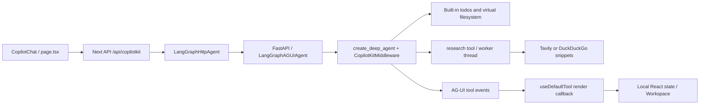

# Enterprise M&A and PE diligence agent: audit and implementation plan

Prepared 19 October 2026. Repository baseline: `d42fb962d886fa552a5c2c03fbb9b4c9f7b613da`.

## 1. Recommendation and scope

Keep Next.js, CopilotKit, AG-UI and LangGraph. Replace the generic research domain with a deal-scoped evidence model, deterministic financial calculations and reviewable IC artifacts. The most urgent change is removing synthetic fallback findings. A prompt change alone cannot make this application suitable for investment diligence.

This deliverable is an audit, benchmark report and implementation plan. Application files have **not** been changed. [01-discovery-foundation.patch](./01-discovery-foundation.patch) contains exact, reviewable diffs against the inspected checkout. [build_proposal.py](./build_proposal.py) regenerates those diffs without altering application files.

**Patch boundary:** the patch implements the five-stage persona, removes fabricated fallback sources, wires four discovery tools into the agent and event allowlist, adds phase/evidence labels, rebrands the workspace, corrects tool-card paths and enables Markdown tables. Its financial/competitor/news tools explicitly return unavailable numeric results or unvalidated discovery leads. It does **not** implement a validated extraction engine, durable state, authentication, numerical valuation or production risk scoring. Those are specified below in dependency order. Applying the patch alone is not completion of the enterprise upgrade.

The product should distinguish `discovered`, `retrieved`, `extracted`, `reviewed` and `approved`. A citation makes a claim inspectable; it does not prove that the claim is accurate or eliminate hallucinations.

## 2. Codebase discovery and audit

### Actual data flow



The stable routing name is `research_assistant`, present in `agent/main.py`, the Next API route and `src/app/layout.tsx`. Keep this identifier during the domain pivot; renaming only one side breaks routing. Product labels can change independently.

### Backend findings

| Location | Observed behavior | Implication / adaptation |
|---|---|---|
| `agent/agent.py:24` | Generic planning/research/report prompt | Replace with the five mandatory deal stages, artifact contract, provenance and uncertainty rules. |
| `agent/agent.py:40` | Provider factory, temperature 0.7; explicit tools are only `[research]` | Preserve provider choice; register domain tools. Lower temperature can be evaluated later but is not a financial accuracy control. |
| `agent/agent.py:47` | `create_deep_agent` with `CopilotKitMiddleware`, `MemorySaver`, recursion limit 100 | Built-in tools supply plan/filesystem behavior; no custom deal state or enforceable stage gate is defined here. Memory is process-local, not durable storage. |
| `agent/tools.py:25` | DuckDuckGo HTML regex parsing, 8-second request timeout | Returns snippets, not verified original-document extraction. Redirect URLs require normalization. HTML layout changes can silently reduce coverage. |
| `agent/tools.py:58` | Failed search returns invented Wikipedia/arXiv findings | Critical: fabricated evidence is presented through the normal source pipeline. Remove completely; test offline and blocked-network cases. |
| `agent/tools.py:79` | Tavily `include_raw_content=False`, content truncated to 3,000 characters | README claims of full-page grounding exceed the implemented behavior. Search should discover documents; a second step must retrieve and anchor evidence. |
| `agent/tools.py:120` | `research()` creates a nested deep agent, tracks search results in a closure, asks it to search once | A short prose summary plus a bag of URLs does not map individual claims to evidence. One search is also insufficient for exhaustive diligence. |
| `agent/tools.py:186` | A new `ThreadPoolExecutor(max_workers=1)` per call; blocking `future.result()` | Intended to avoid inherited callback context. This is not a security boundary or proof that all versions prevent callback leakage. No overall deadline/cancellation propagation; each concurrent call creates another pool. |
| `agent/main.py:69` | `copilotkit_customize_config(emit_tool_calls=[...])` allows research/todos/write/read/edit events | Add all four tools here as well as to `build_agent`. A tool can run correctly but be absent from expected UI events if integration is incomplete. |
| `agent/main.py:28` | Wildcard CORS with credentials; no authentication in inspected endpoints | Add explicit allowed origins and identity enforcement before confidential deal use. CORS does not authorize users. |
| `agent/telemetry.py` | Global in-memory list includes raw query arguments; no tenant/deal IDs, bounded storage or explicit synchronization | Deal queries may be sensitive. Use redacted, access-controlled audit events and durable retention policy. The “thread-safe” docstring is not implemented with locking. |

Worker isolation currently avoids passing an explicit parent runnable configuration to the nested invocation. Preserve that behavior only with a regression test that records parent stream events and verifies that internal search/worker tokens do not appear. Explicitly forward a safe trace ID, cancellation signal and server-derived deal context without forwarding unwanted callbacks. A timeout on `future.result()` alone is insufficient: exiting an executor context can still wait for its worker. Bound underlying HTTP/LLM calls and use a cancellable job model for long runs.

### Frontend findings

| Location | Observed behavior | Consequence |
|---|---|---|
| `src/app/page.tsx:10` | `useState(INITIAL_STATE)` owns workspace; no `useCoAgent` hydration | Workspace is an event projection, not an authoritative backend snapshot. Reload/reconnect cannot be relied upon to reconstruct it. |
| `src/app/page.tsx:17` | Render callback records dedupe keys, then schedules `queueMicrotask(setState)` | Rendering has side effects. Replay, abandoned renders and Strict Mode can produce missed/duplicate updates. Move ingestion out of render. |
| `src/app/page.tsx:19` | Key combines args, result length and first 100 result characters | Distinct results can collide; repeated legitimate operations can be suppressed; set grows without a run boundary. Use actual run/tool-call IDs and revisions from the event layer. |
| `src/app/page.tsx:32` | Casts `research` result to an object without runtime decoding | Serialized JSON or malformed results are not handled reliably. Validate payloads once for both cards and state. |
| `src/app/page.tsx:45` | Appends all sources | Duplicate URLs, no claim IDs, source versions, page locations or credibility basis. |
| `src/app/page.tsx:59` | Todos replace current list; IDs fall back to `Date.now()` | IDs shift unnecessarily. Built-in todo fields should remain compatible; derive phase from a stable prefix initially. |
| `src/app/page.tsx:73` | Completed `write_file` appends arguments as a new file | Completion is not proof of successful write. Failed writes may appear saved; paths duplicate. There is no `edit_file` reconciliation. |
| `Workspace.tsx:405` | Three collapsible sections, not actual tabs | Rename sections first. A real tab layout is optional and should preserve accessibility and responsive behavior. |
| `Workspace.tsx:319` | Modal stores selected file object | After authoritative revisions are added, select by path/ID and resolve latest content to avoid stale previews. |
| `Workspace.tsx:329` | Consolidated Markdown export, Copy All, per-file download already exist | Reuse these. Add per-file copy, clipboard error handling and export manifest, not a second export pipeline. |
| `FileViewerModal.tsx:153` | `react-markdown` without GFM | Pipe-style valuation tables do not render as tables. Add `remark-gfm`; retain safe HTML behavior. |
| `ToolCard.tsx` | `args.path` for read/write but actual middleware uses `file_path`; all completed calls show success styling | Correct paths and separate execution status from result status. Domain `partial`/`unavailable` must not receive an unqualified success badge. |
| `src/types/research.ts` | Minimal todo/file/source interfaces | No deal, currency, period, citations, metric definitions, revisions, approvals or evidence coverage. |

The baseline has no document upload/OCR pipeline, private VDR connectors, entity resolution, financial normalization, calculation service, cited risk model or per-deal authorization in the inspected source. These are substantive additions, not UI relabeling.

### Build and operational evidence

- `npm run typecheck` failed before changes: `next.config.ts:6` unused `@ts-expect-error`; `next.config.ts:8` webpack callback parameter `config` implicitly has `any` type. Resolve the Next configuration type issue before treating subsequent typechecks as release gates.
- `package.json` requests Next `^16.1.1`; README says 16.3. Treat manifest/lockfiles as dependency evidence, not README badges.
- `agent/uv.lock` records Deep Agents 0.3.8 and CopilotKit 0.1.76; `pyproject.toml` permits broad lower-bound upgrades. The lock includes Google and Anthropic integrations transitively; direct imports should have explicit dependency declarations.
- Dockerfiles use install commands without enforcing existing lockfiles. Use `npm ci` and a locked `uv` installation after validating the intended versions. Check the backend image's availability of `curl` used in its healthcheck.
- `MockChatModel._generate` returns a dictionary rather than the expected model result object and does not implement tool binding. Treat zero-key demo boot/tool support as unverified; do not use it as an acceptance test for diligence.
- No project `AGENTS.md`, `DESIGN_SPEC.md` or application test files were found by the scoped file inventory. Live provider execution and browser end-to-end behavior were not tested in this report task.

## 3. Industry research and feature benchmarking

Research uses official product, engineering and help documentation. These support statements about documented functionality, not independently measured accuracy. Public materials do not disclose a universal proprietary diligence schema or risk formula; the schemas in section 5 are recommendations for this application.

### Hebbia / Matrix

Hebbia describes a spreadsheet-style interface with document retrieval, question decomposition into columns, extraction and synthesis. Its engineering account separates orchestration, retrieval and output formatting, with typed context and trace identifiers. **Adaptation:** each matrix cell should be a separately addressable question/answer/evidence object; re-run a failed cell without regenerating the whole memo. Keep evidence retrieval separate from narrative compilation. [Hebbia engineering](https://www.hebbia.com/blog/divide-and-conquer-hebbias-multi-agent-redesign)

Hebbia's published credit workflow includes covenant comparisons across documents; its deal-lifecycle material describes financial, commercial, operational and legal workstreams and source-linked draft outputs. **Adaptation:** compare covenant thresholds, definitions, exceptions and document versions, not just whether a keyword exists. Expose unanswered checklist rows. [Credit workflows](https://www.hebbia.com/blog/how-private-credit-teams-use-hebbia), [deal lifecycle](https://www.hebbia.com/resources/deal-lifecycle)

Its October 2025 release describes public-filing comps exported to Excel, reusable drafting templates and CapIQ data in Matrix columns. **Adaptation:** use a typed comps dataset as the source for both Markdown and eventual XLSX; don't reverse-parse narrative tables to recover numbers. [Hebbia release notes](https://www.hebbia.com/blog/the-disclosure-october-2025)

### AlphaSense / Tegus

AlphaSense's diligence workspace documents a sequence of VDR orientation, live diligence and output generation, including identifying missing materials. **Adaptation:** run a document inventory/coverage check before answering diligence questions; a beautiful memo with incomplete records remains incomplete. Keep analyses and follow-up requests in the same deal workspace. [Due Diligence Workspace](https://help.alpha-sense.com/hc/en-us/articles/51920171391635-Due-Diligence-Workspace-Overview)

Generative Search opens cited source passages for review. Its API documents Markdown citation formats with document IDs and page deep links. **Adaptation:** preserve machine-readable evidence IDs beneath rendered links; provide a source drawer with document version, page/section, supporting excerpt and observation date. A URL at the bottom of a memo is insufficient traceability. [Reviewing responses](https://help.alpha-sense.com/hc/en-us/articles/41666587181203-Interacting-with-Generative-Search), [citation API](https://developer.alpha-sense.com/agent-api/response-parsing)

Its platform combines filings, news, broker research, standardized financials and Tegus expert transcripts. **Adaptation:** these are separate entitlement-aware retrieval channels, not interchangeable public web search results. Expert commentary should preserve interview date, relevant role and the distinction between opinion and reported operating facts. [Platform](https://www.alpha-sense.com/platform/generative-search/)

AlphaSense's sentiment documentation describes sentence-level polarity and company/time comparisons. **Adaptation:** treat tone as a research signal, separate from the adverse-event ledger. A negative sentence is not a finding of misconduct, and an executive departure is not automatically negative. [Sentiment methodology](https://help.alpha-sense.com/hc/en-us/articles/41711605431059-How-We-Calculate-Sentiment)

### Harmonic and PitchBook

Harmonic describes growth-investor workflows using company/team signals and peer comparisons, with headcount and hiring changes as inputs. **Adaptation:** store dated observations with source and coverage; never equate employee growth with revenue growth. Resolve the company's website/legal entity before joining records. Founder employment history is a diligence lead, not a completed background check. [Harmonic growth capital](https://harmonic.ai/blog/how-harmonic-serves-growth-capital-investors), [company signals](https://harmonic.ai/case-study/mvp-ventures)

PitchBook's diligence offering emphasizes financing history, capital structures, teams and precedent transactions. **Adaptation:** maintain separate public-trading and transaction-comps tables. Preserve transaction date, stake acquired, consideration basis and whether the valuation is equity or enterprise value. Do not mix funding-round post-money valuations directly with acquisition enterprise values. [PitchBook diligence](https://pitchbook.com/use-cases/due-diligence)

### FinChat / Fiscal.ai and Koyfin

Fiscal.ai, formerly FinChat, documents click-through datapoint auditability and separate as-reported and standardized views. **Adaptation:** keep both original reported values and normalized values with transformation lineage; never silently overwrite the original with an adjusted value. [Fiscal.ai product update](https://newsletter.fiscal.ai/p/our-biggest-update-ever), [company naming](https://fiscal.ai/blog/finchat-signs-deal-with-ycharts)

Koyfin documents financial templates, historical annual/quarterly analysis, actuals versus consensus and definitions for valuation metrics. **Adaptation:** the comps UI needs period and accounting-basis selectors; each multiple must record its exact denominator and market-price date. A provider's EV/EBITDA definition can include adjustments, so identical labels do not prove comparability. [Financial analysis](https://www.koyfin.com/features/financial-analysis/), [actuals/consensus](https://www.koyfin.com/help/actuals-consensus/), [data dictionary](https://www.koyfin.com/help/koyfin-data-dictionary/)

These sources support borrowing interface and provenance patterns. They do not establish that we have access to vendor data or redistribution rights. Confirm licensed API/export scopes, retention and attribution before building integrations; do not assume a product subscription permits programmatic ingestion.

### Patterns to carry into this repository

| Pattern | Product behavior | Repository change |
|---|---|---|
| Reusable questions | Standardize diligence but expose missing evidence | Template checklist with phase, workstream, owner and completion reason. |
| Evidence at answer/cell level | Make contradictions and unsupported claims visible | Claim/evidence graph; click a metric or risk to inspect its support. |
| Comparable units | Separate periods, currencies and accounting policies | Typed metric observations plus deterministic calculation service. |
| Private + public context | Search each corpus with its permissions | Server-side connector registry, per-deal access checks, explicit search scope. |
| Human review | Distinguish draft analysis from approved decisions | Versioned artifacts, review assignments and approval event bound to content hash. |
| Iterative analysis | Refresh changed evidence without losing decisions | Dataset versions, dependencies and invalidation of affected memo/risk sections. |

## 4. Workflow and domain tools

### Deal context and mandatory stage gates

Capture `deal_id`, server-derived `tenant_id`, canonical company ID, legal name, website, ticker/CIK where applicable, sector, geography, transaction type, reporting currency, valuation date and scope. Ask for disambiguation when multiple companies match. A private company without SEC records is a normal case, not an error to conceal with peer financials.

| Stage | Required work | Exit evidence |
|---|---|---|
| 1. Preliminary Screening & Deal Thesis | Business model, ownership, investment thesis, scope and disconfirming questions | Identity resolved; thesis and document request list captured. |
| 2. Financial Performance & Valuation Benchmarking | Historical financials, QoE adjustments, working capital, cash conversion, debt and comps | Reconciled periods/units or explicit gaps; calculation lineage; peer inclusion rationale. |
| 3. Commercial & Competitive Moat Analysis | Customers/concentration, retention, pricing, market map, moat, team, technology/IP | Evidence-backed comparisons; contradictions and unavailable market shares visible. |
| 4. Red Flags & Downside Risk Assessment | Commercial, financial, operational, legal, technical and ESG risks | Scored or explicitly unassessed risks, mitigations, owners and downside cases. |
| 5. Executive Investment Memo Compilation | Thesis, economics, downside, outstanding diligence and conditions | Three artifacts, coverage report, unresolved issues, reviewer assignment. |

The first patch expresses these stages in the prompt and todo prefixes. Production must enforce them with graph state/conditional transitions. A model marking all todos complete cannot bypass unresolved mandatory evidence or human approval. Stage completion can mean “reviewed with a documented gap,” not “missing data magically filled.”

Checklist workstreams cross stage boundaries:

| Workstream | Example questions / required materials |
|---|---|
| Financial | Revenue recognition, recurring vs nonrecurring revenue, EBITDA bridge, cash conversion, working capital, debt-like items, tax exposures, audited statements and QoE. |
| Commercial | Market definition, customer concentration, cohort retention, churn/NRR, pricing, pipeline conversion, competitor win/loss evidence. |
| Legal | Ownership/cap table, material contracts, change-of-control clauses, IP ownership, litigation and regulatory filings; counsel review of conclusions. |
| Technical | Architecture, security incidents, technical debt, uptime, software licenses, data rights, product dependencies and remediation costs. |
| Operational / people / ESG | Key-person exposure, management turnover, supplier concentration, controls, labor/environmental issues and evidence-backed remediation. |

### Production tool specifications

All four public tool signatures requested in the task remain stable. Deal metadata and authorization come from server runtime context, not model-provided tenant IDs. Use a versioned result envelope: `schema_version`, `status: ok|partial|unavailable|error`, `data`, `sources`, `limitations`, `retrieved_at`, `coverage` and a stable invocation ID. UI execution completion and business result status are separate fields.

**`sec_filing_search(ticker_or_company, filing_type)`**

1. Resolve exact ticker/company to CIK; return ambiguity candidates rather than picking arbitrarily.
2. Query SEC submissions; filter form and deal as-of date; follow historical submission files when needed. Preserve original/amended filing relationships.
3. Retrieve original filing, accession number, filing/report dates and extracted sections. Index 10-K Item 1A and relevant 10-Q risk-factor updates; missing updated risk factors do not imply absence of risk.
4. Return filing metadata and source anchors. Financial facts come from the XBRL/facts path, not from search snippets.

SEC public submissions and company-facts APIs do not require API keys; use backend requests, declared User-Agent/contact, caching, bounded retries and a shared rate limiter below the documented 10 requests/sec maximum. Public data APIs differ from authenticated EDGAR filing-submission APIs. [SEC data APIs](https://www.sec.gov/search-filings/edgar-application-programming-interfaces), [SEC access guidance](https://www.sec.gov/about/webmaster-frequently-asked-questions)

**`financial_metrics_extractor(target_company)`**

Use SEC company facts for covered public entities and authorized VDR documents for private companies. Extract candidate facts with page/table/cell anchors; validate entity, dates, unit, currency, scale and accounting basis. Store revenue, EBITDA/adjusted EBITDA, ARR and gross margin independently. ARR and EBITDA may be absent or nonstandard; return unavailable rather than substitute unrelated tags. Calculate CAGR only from comparable positive endpoints and a documented interval. Structured extraction by an LLM still requires schema, anchor and reconciliation checks.

**`competitor_matrix_generator(sector, target_company)`**

Resolve peers by product, customer, geography, scale and business model. Record inclusion/exclusion rationale. Each pricing/moat/share cell carries evidence IDs, date and confidence basis. Market share requires a defined market and period; missing share remains null. Separate management claims from independent analysis. Attach normalized financial comps after calculation; a prose comparison is not a valuation engine.

**`news_sentiment_check(target_company)`**

Search a recorded date range across approved news, regulator/company announcements and licensed employee-review sources. Resolve entity, deduplicate syndicated stories, distinguish event date from publication date and preserve allegation/resolution status. Emit event category, factual excerpt, source IDs, relevance and confidence. Sentiment is optional and separately modeled; missing coverage is not a clean bill of health. Do not claim Glassdoor access until a permitted data path exists.

### Services needed beyond the four tools

`DocumentIngestion` → `EvidenceStore` → `MetricNormalizer` → `ValuationCalculator` → `RiskAssessment` → `ArtifactValidator` → `ReviewerApproval`.

Keep numerical calculations in ordinary code using decimal arithmetic, with explicit rounding at presentation. The model selects relevant questions and explains results; it must not supply uncited numbers to a calculator and thereby make them appear validated.

## 5. Proposed schemas and numerical policies

These are our recommended contracts, not claims about vendor internal schemas. Implement shared JSON Schema/Pydantic contracts and generate TypeScript types; validate every inbound event at runtime.

| Entity | Required fields |
|---|---|
| Diligence item | `id, deal_id, phase, workstream, question, owner, status, required_evidence, evidence_ids, gap_reason, reviewed_by` |
| Document | `id, deal_id, source_type, canonical_url/storage_key, title, publisher, published_at, retrieved_at, content_hash, version, access_scope` |
| Evidence | `id, document_id, document_version, page/section/table/cell, excerpt, extraction_method, verification_status` |
| Claim | `id, deal_id, text, type(fact/inference/assumption), evidence_ids, contradiction_ids, review_status` |
| Metric observation | `id, entity_id, metric, value_decimal/null, unit, scale, currency, period_start/end, fiscal_period, period_kind, basis, source_tag, accession, filed_at, evidence_ids, missing_reason` |
| Derived metric | `id, metric, value_decimal/null, formula_version, input_metric_ids, normalization_steps, rounding_policy, status` |
| Comparable | `entity_id, inclusion_reason, trading_or_transaction, valuation_date, metric_ids, multiple_ids, excluded_reason` |
| Risk | `id, category, claim, evidence_ids, likelihood, impact, score, score_policy_version, status, mitigation, owner, residual_score, reviewer` |
| Artifact | `id, deal_id, canonical_path, content, revision, content_hash, input_versions, created_at, review_status, approved_by/at` |

Example proposed metric record (illustrative schema, not live company data):

```json
{
  "id": "metric-revenue-fy-example",
  "entity_id": "example-company",
  "metric": "revenue",
  "value_decimal": null,
  "unit": "currency",
  "scale": 1,
  "currency": "USD",
  "period_start": "2025-01-01",
  "period_end": "2025-12-31",
  "period_kind": "FY",
  "basis": "reported",
  "evidence_ids": [],
  "missing_reason": "Original financial statement not supplied"
}
```

### Financial tables

Comps display: `Company | Business/region | Price as-of | Currency | FY/LTM/NTM basis | Revenue | Growth | Gross margin | EBITDA | EV | EV/EBITDA | P/E | EV/ARR | Evidence | Exceptions`.

Preserve reported and normalized values, and keep trading comps separate from precedent transactions. Render units in headers and period/basis on each row. Metrics with different bases cannot silently contribute to the same median. Show sample size, exclusions and quartiles; never produce a peer statistic from an empty or ineligible set.

Recommended calculation rules, subject to the firm's accounting/valuation policy:

- Revenue growth = `current / comparable_prior - 1`; nonpositive or missing comparison base is unavailable with reason.
- CAGR = `(end / start)^(1 / years) - 1`; positive values and a positive, comparable time interval required.
- Gross margin = `gross_profit / revenue`; retain percentage precision and show N/A when the denominator is unusable.
- Enterprise value bridge = equity value + debt + preferred interests + noncontrolling interests − eligible cash, with lease/debt-like item policy explicitly recorded. Align market-date and balance-sheet-date inputs and flag timing gaps.
- EV/EBITDA uses compatible normalized EBITDA; P/E uses compatible equity value/net income or price/EPS. Nonpositive denominators are NM, not meaningful negative/zero multiples.
- EV/ARR requires an actual recurring-run-rate disclosure and its definition; total revenue is not ARR.
- LTM is four nonoverlapping comparable quarters, or last FY + current YTD − prior comparable YTD. Do not sum overlapping cumulative 10-Q facts.
- Restatements and amendments must obey the deal's as-of date. Do not blindly take the most recently filed fact when reconstructing historical knowledge.
- Base/upside/downside projections are assumptions with provenance for starting values. Show revenue growth, margin, exit multiple and leverage sensitivities; an illustrative scenario is never consensus.

Implement these as versioned, tested pure functions. Evidence links on derived values point to both the formula and all underlying observations. Full LBO/IRR modeling is a later extension requiring cash-flow timing, fees, debt amortization, covenants and exit assumptions; a markdown comps table is not an LBO model.

### Risk matrix / heatmap

Use a configurable 5×5 likelihood-impact grid. Proposed score = likelihood × impact; illustrative bands: 1–4 low, 5–9 moderate, 10–16 high, 17–25 critical. These are proposed firm policy, not a vendor standard or calibrated default probability model. Legal/compliance stop conditions can override the numeric band.

Likelihood anchors: 1 remote, 2 unlikely, 3 plausible, 4 likely, 5 occurring/near-certain within the stated horizon. Impact anchors: 1 immaterial, 2 limited, 3 material/remediable, 4 thesis-threatening, 5 threatens viability or transaction permissibility. Define materiality relative to the deal and calibrate with the investment team. Evidence confidence is a separate field; weak evidence must not automatically lower risk.

Missing likelihood or impact produces `unassessed`, not a score of zero. Maintain inherent and residual scores, reviewer rationale, mitigating evidence, owner and due date. Show textual severity and evidence gaps as well as color. Contradictory evidence remains visible and triggers review.

## 6. Workspace, state synchronization and deliverables

### Required report contracts

| Virtual path | Required sections |
|---|---|
| `/reports/01_executive_investment_memo.md` | Deal snapshot and as-of date; business model; thesis; investment highlights; disconfirming evidence; market/moat; financial summary; valuation range; downside; conditions to proceed; open diligence; citations; review status. |
| `/reports/02_financial_valuation_model.md` | Sources and accounting policies; historical financials; EBITDA adjustments; comps and peer rationale; EV/equity bridge; multiple analysis; assumptions and revenue projections; sensitivity cases; missing inputs; calculation/evidence references. |
| `/reports/03_risk_matrix_and_red_flags.md` | Scoring policy; severity matrix; commercial/financial/operational/legal/technical/ESG risks; evidence and counterevidence; likelihood/impact; mitigation; residual risk; owner; due dates; unassessed items. |

Each carries `deal_id`, target, as-of date, currency, generation time, revision and Draft/Reviewed/Approved label. Backend validation must check the paths, required sections, evidence references and numeric consistency. Prompt instructions alone do not enforce output contracts. Draft generation may proceed with gaps; an approval transition requires authorized human action against the exact artifact revision.

### Workspace behavior

- **Due Diligence Checklist:** stage badges plus workstream, owner, pending/in progress/completed/blocked state, gap reason and evidence coverage. Phase prefixes are a compatible first step; dedicated graph state should replace parsing over time.
- **Deal Room Artifacts:** latest revision per path, Markdown tables, instant preview, per-file copy/download and consolidated export. Display Draft/Needs review prominently. Keyboard-operable file entries, modal focus trapping and clipboard failure feedback belong in the UI acceptance checklist.
- **Evidence & Citations:** source class, retrieved date, document date, reviewed/extracted/discovery status and source excerpt. “Regulatory source” is a provenance category, not a truth score. A regulator-hosted company filing is still a company disclosure.
- Later add a Matrix view for question × document/company and a quantitative table view; keep both backed by the same typed records as the memo.

### Correct state model

The proposed foundation patch deliberately retains current event mirroring; it only upserts paths and deduplicates URLs. This remains insufficient for production. Implement the following before a real-deal pilot:

1. Backend owns `DealState`; persist graph checkpoints and deal records with tenant/deal scoping. Virtual `/reports/` paths remain stable within each deal, not globally shared across deals.
2. Emit/retrieve snapshots with `deal_id`, `run_id`, revision and typed collections; publish only successful committed changes. Add authorization to every read, stream and export.
3. Ingest events through a subscription/effect outside React render. The inspected catch-all render props do not expose a tool-call ID; obtain IDs from the underlying AG-UI message/event layer rather than inventing a field on `useDefaultTool`.
4. Decode object/string payloads once; runtime-validate; distinguish tool execution errors from domain unavailability. Reject malformed events with a visible error, not a blank success card.
5. Upsert by stable IDs and monotonically increasing revisions. `write_file` and `edit_file` both reconcile from committed backend content, not tool arguments. A failed write must never create a visible artifact.
6. On reconnect, refresh the snapshot and then consume later events. Ignore replayed/older revisions; retain legitimately repeated actions with different invocation IDs.
7. Store selected artifact ID/path, resolving current content from state. Changing deals clears local projection and transient dedupe state.

Suggested reducer invariants:

```text
event.deal_id != active_deal_id       => ignore
event.revision <= stored.revision    => ignore replay/stale event
event.status != committed            => show error/progress; do not mutate artifacts
artifact_updated(path, revision)     => replace that path, including edits
snapshot(revision)                   => hydrate collections atomically
```

## 7. Exact diffs and implementation order

### Review-only foundation patch

The linked patch contains complete unified diffs, without ellipses, for:

1. `agent/agent.py`: Principal PE persona, five stages, fixed artifacts and four tool registrations.
2. `agent/tools.py`: remove synthetic search fallback; label demo research unavailable; four explicitly limited discovery adapters and source metadata.
3. `agent/main.py`: add tools to emitted calls; server labels, preserving agent routing ID.
4. `src/types/research.ts`: optional phase and provenance fields for migration compatibility.
5. `src/app/page.tsx`: handle domain-tool sources, dedupe URLs, stable todo IDs/phase prefixes, upsert files and deal-focused copy.
6. `src/components/Workspace.tsx`: requested section labels, phase badges and evidence status labels; reuse preview/export/copy-all.
7. `src/components/ToolCard.tsx`: domain-tool summaries and correct `file_path` lookup.
8. `src/components/FileViewerModal.tsx` and `package.json`: GFM table rendering.

The patch does not fix all audited defects. In particular, render-phase state updates, tool-result failure handling, serialized result decoding, durable state, edits, green completion styling and per-file copy need the subsequent UI/state change. Do not treat optional schema fields as security or evidence validation. It also does not update the lockfile: after applying the proposal, run `npm install` and commit the resulting lockfile with the dependency change before using `npm ci`.

Review commands from repository root:

```powershell
python docs/ma-diligence/build_proposal.py
git apply --check docs/ma-diligence/01-discovery-foundation.patch
# During implementation, after review:
git apply docs/ma-diligence/01-discovery-foundation.patch
npm install
```

### Dependency-ordered delivery plan

| Order | Concrete change / files | Acceptance gate |
|---|---|---|
| 0 | Fix `next.config.ts` baseline typing; lock dependencies; repair or explicitly disable mock tool mode; reconcile README claims | Clean typecheck and reproducible backend import/start under a supported provider. |
| 1 | Apply reviewed foundation diff; add explicit empty/error search behavior and mock isolation tests | Network failures yield zero fabricated evidence; all four tools appear in AG-UI; result status stays partial/unavailable until validated. |
| 2 | Add `agent/schemas.py`, generated frontend contracts and `agent/evidence_store.py`; deal identity and document provenance | Unknown company is unresolved; citations resolve to exact document versions; malformed payloads are rejected. |
| 3 | Add durable checkpoints, authorization, scoped storage and `/deals/{id}/workspace` snapshot contract; migrate page state into a validated reducer/subscription | Cross-deal requests denied; restart/reload works; replay/out-of-order/failed write/edit cases reconcile correctly. |
| 4 | Add `agent/connectors/sec.py` and VDR ingestion; document hashes, OCR/table extraction and injection-resistant retrieval | Public fixture yields correct filing/CIK/period anchors; private-company fixture records gaps; authorization filters precede retrieval. |
| 5 | Replace discovery-only internals with financial extraction/normalization; `agent/valuation.py` | Independent arithmetic tests pass; every non-null value has source or derivation; mismatched periods/currencies are rejected. |
| 6 | Implement peer selection and adverse-event tools with entitled vendor adapters where available | Peer rationale documented; conflicting evidence retained; news deduplicated; no-news case stays unknown coverage. |
| 7 | Add risk policy, workflow stage gates and report validators; persist graph stage transitions | Missing evidence blocks approval; three canonical artifacts share the same metric/risk records and source versions. |
| 8 | Complete UI: truthful statuses, snapshot sync, current previews, per-file copy, citation drawer, risk table/heatmap and accessible controls; update layout metadata | Browser tests cover tables, source links, exports, retries, edits, reconnection and deal switching. |
| 9 | Security/operations gate, reviewer pilot and evidence-quality evaluation | Tenant isolation, retention, redaction, egress controls, latency/cost limits and approved-reference evaluation pass. |

These stages should be separate reviewable changes. Data access, auth/storage choices and the firm's financial/risk policies are implementation dependencies; they do not prevent preparing this plan or reviewing the foundation diff.

## 8. Enterprise boundaries and validation

Before confidential deal use: authenticate the Next API and backend, authorize thread/deal ownership server-side, use explicit CORS origins, encrypt persisted documents, enforce retention/deletion and document-level entitlements, and redact queries from routine telemetry. Enforce public/private egress boundaries in code; a prompt warning does not prevent confidential content from reaching search providers. Retrieved documents are untrusted inputs, including tool-instruction-like text.

Add immutable audit events linking actor, deal, run, tool-call ID, document versions, calculation version and artifact hash. Propagate safe trace context through workers. Bound retrieval concurrency, request size, retries and cost; support cancellation and observable partial completion. Set up a real document ingestion path with file validation and parsing limits before enabling uploads.

### Required verification suite

| Test | Expected result |
|---|---|
| Tavily unavailable + blocked fallback | No synthetic findings, explicit unavailable status, no fabricated links. |
| Entity ambiguity / private target without filings | Disambiguation or missing-data request; never another company's facts. |
| Annual/quarter/YTD overlap and amendments | Correct comparable periods; no look-ahead data after valuation date. |
| Currency/scale/unit mismatch | Reject or explicitly normalize with traceable conversion; never silently mix millions and units. |
| Negative EBITDA, zero earnings, missing ARR | NM/N/A with reason, no fabricated multiple. |
| Claim with irrelevant citation / conflict | Fails support review or is marked unresolved; valid URL alone is insufficient. |
| Search snippet vs full original | Distinct verification states; only retrieved/extracted evidence supports factual numeric extraction. |
| Stream replay, failed writes and edits | One current artifact per path, no phantom file, latest committed content survives reload. |
| Tenant A requests tenant B's thread/source | Denied in snapshots, streaming, retrieval and export. |
| Worker execution | No internal worker callbacks in parent stream; cancellation/deadline behavior measured. |
| Prompt injection in VDR / public source | Document cannot change tool policy, access scope or reviewer status. |
| Memo with unresolved critical risk | Draft can be produced; approval requires authorized reviewer and recorded disposition. |

Evaluate a small, permissioned benchmark of a public target, a private-company fixture, a disputed/restated financial case and a thin-evidence case. Have a deal professional label correct figures, acceptable peer choices, material risks and supporting passages. Measure numeric accuracy, citation support, mandatory-risk recall, gap disclosure, duplicate/replay robustness, runtime and cost. Set production thresholds with reviewers; source count alone is not an accuracy metric.

### Verification performed for this deliverable

Application source and relevant runtime/dependency configuration were inspected; official vendor and SEC materials were researched. Baseline typecheck failed as documented. The proposal generator syntax-checks candidate Python files. Patch applicability is checked separately and recorded in the companion validation note. No live extraction, paid-data access, UI end-to-end test or production deployment is claimed.
